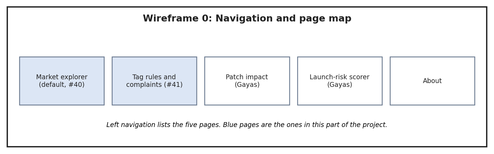
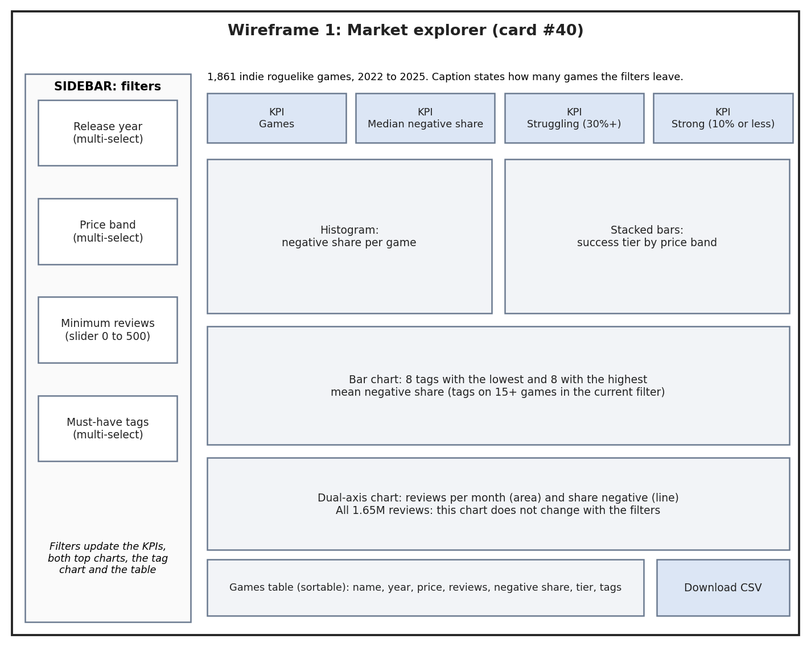
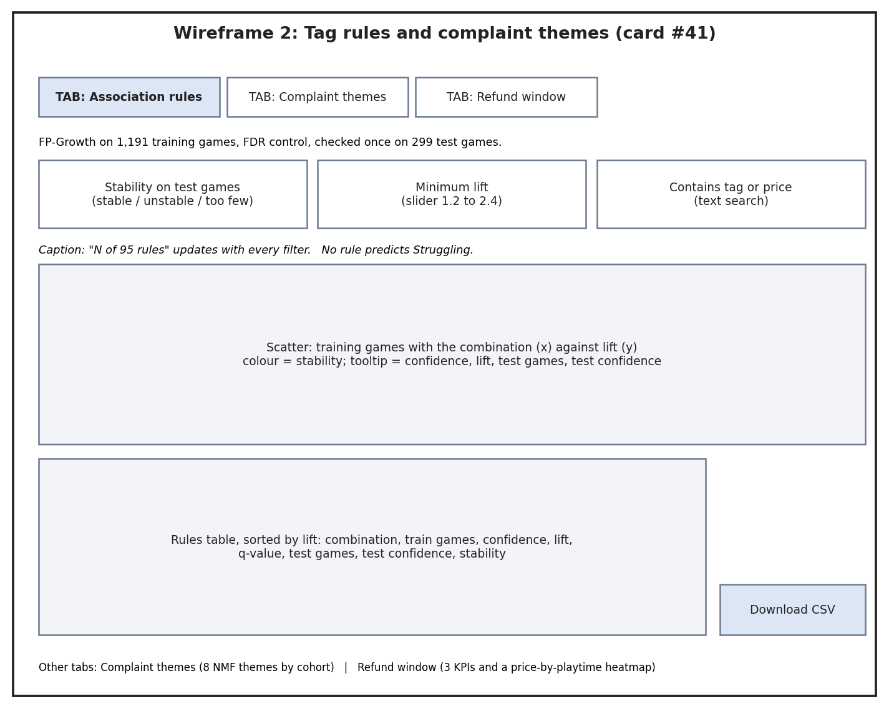

# Dashboard wireframe (card #37)

Owner: Srihitha. Pages: Market explorer (#40) and Tag rules and complaints (#41). Page map, layouts and the controls on each page.

## What each control updates

| Control | Updates | Does not update |
| --- | --- | --- |
| Release year, Price band (page 1) | KPIs, histogram, tier-by-price chart, tag chart, games table | Reviews-over-time chart (all reviews, not by game) |
| Minimum reviews (page 1) | Same; default 20 gives 1,490 games, 0 gives all 1,861 | Reviews-over-time chart |
| Must-have tags (page 1) | Same; a game must have all chosen tags | Reviews-over-time chart |
| Stability, Minimum lift, tag search (page 2) | Rule count, scatter, rules table, CSV download | Complaint-theme and refund-window tabs |
