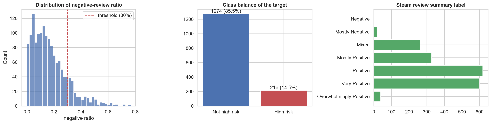
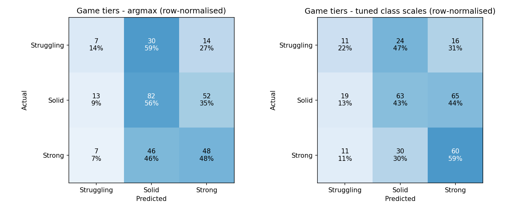
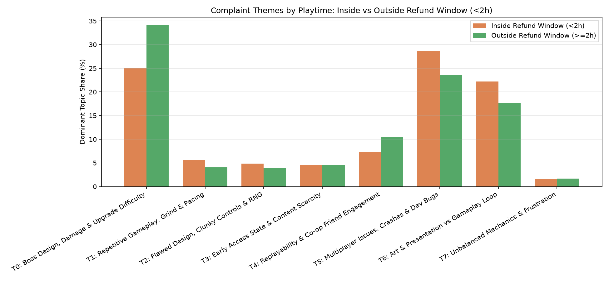
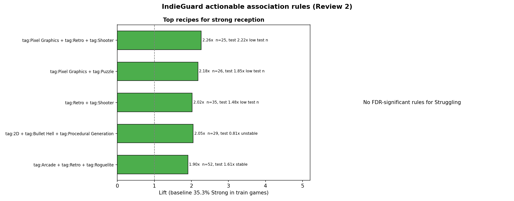
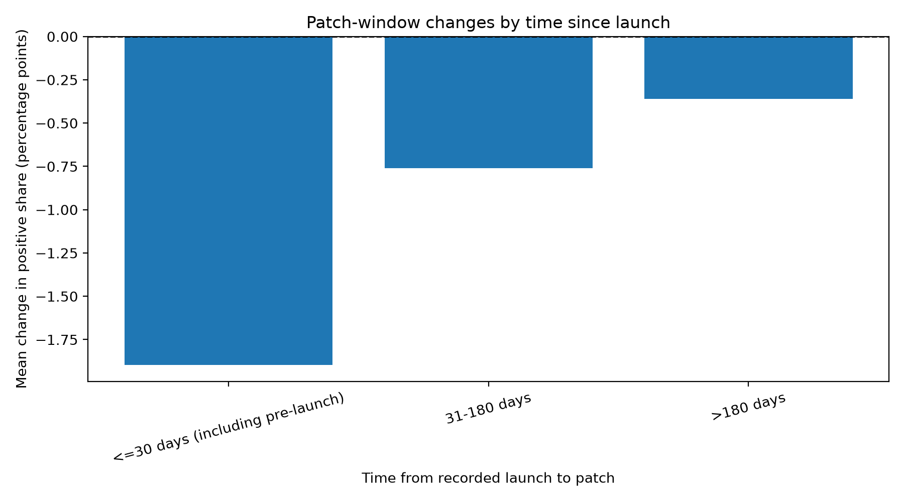

# IndieGuard: Indie Game Launch Analytics

**Predicting negative-review risk and identifying winning feature combinations on Steam**
Business Analytics capstone (23CSE452), Group 1. Final report.

Team: Thotakura Srihitha (CB.SC.U4CSE23450), Gayas Sheik (CB.SC.U4CSE23118), Shantharam P (CB.SC.U4CSE23146), Pradeep Sasidharan (CB.SC.U4CSE23232), Valikala Tejaswini (CB.SC.U4CSE23752).
Code, data tables, results and the project board: https://github.com/Shan713/IndieGuard

## 1. Summary

A small indie studio has little margin for a bad launch. Steam lets a player refund a game played under 2 hours within 14 days, so a negative review written in those first two hours costs a studio twice: the rating and often the sale. We collected our own data on 1,861 indie roguelike and roguelite games (2022 to 2025) and 1.65 million of their reviews, and asked what drives negative reviews, which feature combinations go with strong reception, and whether patches help.

Main findings:

- **The first two hours decide a lot.** Reviews written under 2 hours of play are 21.2% negative against 8.8% later, and they are 29.0% of all negative reviews. Inside that window negativity climbs with price (11.4% under $5, 31.8% at $20 or more); outside it price barely matters.
- **What players complain about changes.** Early negatives lean to crashes, controls and interface; later ones to boss and balance problems and repetition.
- **Store metadata says little about how good a game is.** Game tiers (Struggling, Solid, Strong) reach a macro-F1 of about 0.42 against 0.22 for guessing, and more games would not help. Review-level metadata models reach a PR-AUC of about 0.28 against 0.11 for guessing.
- **The review text is far more informative.** A text model reaches a PR-AUC of 0.84 against 0.36 for metadata on the same English reviews. It detects a negative review from its own words; it does not forecast one.
- **Tag combinations:** low-scope 2D, pixel, retro and procedural-generation combinations go with the Strong tier about two-thirds of the time (against 35% overall). No combination predicts Struggling.
- **Patches:** the positive-review share falls 2.1 points on average after a patch announcement, but launch-period effects and regression to the mean explain it; against matched no-patch windows the difference is +0.27 points, 95% interval [-0.82, +1.36], which includes zero.
- **Hyperparameters** were tuned by grid search on the shared cross-validation folds. Tuning moved cross-validation scores by a few thousandths and did not change which models tie (section 7.3).

All results are associations in observational data, not effects of changing a feature.

## 2. Problem, questions and hypotheses

**Problem.** A studio cannot tell from public information which feature combinations give the best chance of a well-received launch, what drives negative feedback (above all what to fix before the refund window closes), and when a patch is worth the effort.

**Business objective.** Give a small studio or publisher evidence on which feature combinations to back, what to fix before the refund window closes, and when to patch.

| # | Question | Method | Answer in |
| --- | --- | --- | --- |
| 1 | Will a review be negative, and how does that depend on playtime? | Review-level classification, refund-window analysis | 6, 7 |
| 2 | Which success tier will a game land in? | Game-level classification split by game | 7 |
| 3 | Which tag, price and Early Access combinations go with strong reception? | Association rules | 9 |
| 4 | What do players complain about? | Topic modelling and n-gram analysis | 8 |
| 5 | How do ratings change after a patch? | Before and after windows with matched controls | 10 |

| Hypothesis | Verdict |
| --- | --- |
| H1. Reviews inside the refund window are more negative | **Supported:** 21.2% against 8.8%, and in 94% of games with enough reviews |
| H2. The effect is larger for pricier games | **Supported:** 31.8% at $20 or more against 11.4% under $5, inside the window |
| H3. Early complaints differ from later ones | **Supported:** crashes and controls early, balance and repetition later |
| H4. Store metadata alone predicts a game's tier well | **Not supported:** macro-F1 about 0.42 against 0.22 |
| H5. Review text predicts negativity far better than metadata | **Supported:** PR-AUC 0.84 against 0.36 on the same English reviews |
| H6. Some tag combinations go with strong reception | **Partly supported:** 95 Strong rules pass FDR control and 47% of the significant ones hold on the test games; no rule predicts Struggling |

Discount impact (part of question 5 in the plan) was not analysed; only patches were.

## 3. Related work and what is different

Lin et al. studied about 11 million Steam reviews of 6,224 games (a 2016 snapshot) and found that negative reviews come quickly and that players criticise design more than bugs. De Luisa et al. (2021) predict a game's early popularity (player numbers) from price, size, languages, release date and genre with Bayesian models. Jorge and Pardo (2023) built SteamBR, 2.8 million Brazilian-Portuguese reviews, and predict which reviews are helpful.

IndieGuard differs in five ways: a single niche collected whole (99.95% of the reviews Steam reports for the complete games); a focus on playtime at review and the refund window; two linked prediction levels (review and game) with patch timing; a leakage-safe protocol with baselines and honest negative results; and a framing for a studio (what to fix first and when to patch). To our knowledge no earlier Steam study combines these.

## 4. Data

**Acquisition.** Four public Steam sources, collected by our own throttled, resumable scrapers on 1 to 2 October 2026: store search (tags Indie plus five roguelike tags, released 2022 to 2025, giving 1,861 games), store details and tags, SteamSpy owner estimates, and the news feed (29,918 patch and sale announcements). Reviews were paged with Steam's cursor, 100 per page, newest first, with a 1.25 s delay, retries on rate limiting, and checkpoints so a run could resume. Five very large games (Megabonk, Cult of the Lamb, Hades II, Balatro, Vampire Survivors) are capped at their newest 15,000 reviews. Raw data is frozen with row counts and SHA256 hashes (`docs/data_manifest.md`).

**Privacy.** Reviewer IDs are replaced by a salted hash; persona names, avatars and profile links are never stored.

**Cleaning.** 32 logged rules (`docs/cleaning_log.md`). Only unusable rows are dropped: 4,612 empty reviews (1,652,999 to 1,648,387, a 0.28% loss). Everything else is flagged and kept so each analysis chooses its own rule: very short text (208,724), received for free (34,394), written before launch (30,018), playtime outliers above the 99.5% quantile of 363 hours (8,242), ASCII art (4,951), copy-pasted text (2,285). 318 game launch dates were corrected.

**Nature of the data.** About 10.4% of reviews are negative, so accuracy is misleading (always guessing "positive" scores about 89%). A few games hold most reviews. About 60% of reviews are not in English (31 languages). Store attributes are snapshots from October 2026, not launch-time values.

## 5. Targets, split and features

- **Review target:** the review is negative (`voted_up` is false).
- **Game target:** Struggling (30% or more negative reviews), Solid, Strong (10% or less), for games with at least 20 reviews (1,490 games).
- **Split:** by game, 80/20, with 5 cross-validation folds inside train, so no game is on both sides: 1,257,095 training and 316,341 test reviews; 1,191 training and 299 test games. The five capped games are in training only and are left out of the review-level tables.
- **Rules:** anything learned from data is fitted on training rows only; outcome columns (review totals, owner estimates, refund and developer-response shares) are never features; the test set is scored once. `python -m src.features.validate` runs 21 checks.
- **Features:** playtime bucket, refund-window and launch-week flags, days since launch, patch and sale recency, price tier and reviewer and text length; at game level price tier, launch year, DLC, achievements, platforms and controller support. 439 tag and category columns are filtered to 234 and reduced by PCA to 68 components (75% of the training variance, 70.5% on held-out games). Review text goes through TF-IDF and a truncated SVD (78 components).

## 6. Exploratory findings

The refund window is the central pattern (section 1). Reviews are 21.2% negative under 2 hours of play, against 9.1%, 8.1% and 9.9% at 2 to 10, 10 to 50 and 50 or more hours. At game level 14.5% of games are Struggling. Store signals shift a game's risk by a few to about ten points and none is decisive alone: release year (older games have had longer to collect negatives), number of languages, DLC, and listed achievements. Review volume and owner estimates are outcomes, not launch signals. The strongest correlations with the negative share (refund share, developer-response share) are consequences of a bad reception, which is why they are excluded from models.

## 7. Predictive models

### 7.1 Protocol

Five models on both tasks: a Dummy baseline, Logistic Regression, Random Forest, LightGBM and XGBoost, plus text models on English reviews. Metrics are PR-AUC (reviews) and macro-F1 with recall per tier (games), never accuracy alone. Thresholds and class scales are chosen on out-of-fold predictions; the test set is scored once.

### 7.2 Results

Review level, metadata only (guessing PR-AUC 0.106):

| Model | CV mean +/- sd | Test | Test ROC-AUC |
| --- | ---: | ---: | ---: |
| Dummy (prior) | 0.107 +/- 0.024 | 0.106 | 0.500 |
| Logistic Regression | 0.208 +/- 0.024 | 0.194 | 0.663 |
| Random Forest | 0.286 +/- 0.038 | 0.280 | 0.726 |
| LightGBM | 0.287 +/- 0.037 | 0.254 | 0.724 |
| XGBoost | 0.292 +/- 0.037 | 0.275 | 0.729 |

Game level, three tiers (guessing macro-F1 0.22):

| Model | CV mean +/- sd | Test | Recall Struggling | Test 95% interval |
| --- | ---: | ---: | ---: | ---: |
| Dummy (prior) | 0.225 +/- 0.003 | 0.220 | 0.00 | [0.20, 0.24] |
| Logistic Regression | 0.422 +/- 0.033 | 0.423 | 0.39 | [0.36, 0.48] |
| Random Forest | 0.421 +/- 0.038 | 0.404 | 0.14 | [0.34, 0.46] |
| LightGBM | 0.447 +/- 0.019 | 0.421 | 0.45 | [0.36, 0.48] |
| XGBoost | 0.418 +/- 0.044 | 0.388 | 0.14 | [0.33, 0.45] |

Review level with the review text, English reviews (guessing PR-AUC 0.115):

| Model | CV mean +/- sd | Test | Test ROC-AUC |
| --- | ---: | ---: | ---: |
| Dummy (prior) | 0.101 +/- 0.018 | 0.115 | 0.500 |
| LightGBM, metadata only | 0.334 +/- 0.025 | 0.360 | 0.758 |
| LightGBM, metadata + text components | 0.592 +/- 0.026 | 0.593 | 0.895 |
| Logistic Regression, full text + metadata | 0.819 +/- 0.021 | 0.838 | 0.971 |

- **Review level.** The three tree models are about equal (their gaps are smaller than the fold spread of 0.03 to 0.04) and Logistic Regression is weaker, so negativity depends on non-linear patterns. All beat the baseline by about 2.5 times.
- **Game level.** All four real models beat the baseline by a similar margin and the simple ones do as well as boosting; the intervals overlap (299 test games, 51 of them Struggling), so there is no winner. Struggling games are the hard class. More data would not help (a flat learning curve); more information would.
- **With text.** Metadata alone reaches 0.36, 78 compressed text components 0.59, and the full TF-IDF text 0.84 (ROC-AUC 0.97). At the chosen threshold the tuned text model has precision 0.75 and recall 0.79; in the Review 1 notebook a live fit on 60,000 unseen English reviews reached an accuracy of 94.2% against 88.5% for always guessing "positive". It **detects** a negative review from its own words; it does not forecast one.
- **What drives the predictions** (SHAP and permutation importance): review length, Chinese-language reviews and playtime at review at review level; a few tag components (polished store page, roguelite and bullet hell, 2D pixel art) and the number of achievements at game level. These are associations.

### 7.3 Hyperparameter tuning

The first review compared models whose settings had been fixed. We then ran grid searches on the shared folds (plan: `docs/hyperparameter_tuning_plan.md`), evaluating the default as grid point 0, then refitting on full train and scoring the test set once.

| Search | Grid points | Default CV | Tuned CV | Chosen setting |
| --- | ---: | ---: | ---: | --- |
| Review LightGBM | 25 | 0.2814 | 0.2867 | `{"learning_rate": 0.1, "min_child_samples": 200, "num_leaves": 127}` |
| Review XGBoost | 37 | 0.2847 | 0.2918 | `{"learning_rate": 0.03, "max_depth": 8, "min_child_weight": 10, "sub_col": 0.9}` |
| Review Random Forest | 13 | 0.2785 | 0.2808 | `{"max_features": "sqrt", "min_samples_leaf": 20, "n_estimators": 300}` |
| Review Logistic Regression | not yet run | | | |
| Text LightGBM, metadata | 25 | 0.3323 | 0.3339 | `{"learning_rate": 0.03, "min_child_samples": 50, "num_leaves": 63}` |
| Text LightGBM, metadata + text components | 25 | 0.5739 | 0.5922 | `{"learning_rate": 0.1, "min_child_samples": 500, "num_leaves": 127}` |
| Text Logistic Regression (TF-IDF) | 30 | 0.7922 | 0.7938 | `{"C": 3.0, "max_features": 100000, "ngram_range": [1, 2]}` |
| Game Logistic Regression | not yet run | | | |
| Game Random Forest | not yet run | | | |
| Game LightGBM | not yet run | | | |
| Game XGBoost | not yet run | | | |

Tuning moves cross-validation scores by a few thousandths to a hundredth and the test scores do not follow consistently, so the conclusions do not depend on the fixed settings. The one large change, the text Logistic Regression's test PR-AUC from 0.785 to 0.838, comes mostly from refitting the TF-IDF vocabulary on all 437k training reviews (before: a 100k sample) and allowing 100k terms, not from the grid, which moved cross-validation by only 0.002.

## 8. Text mining and complaint themes

On the English corpus (557,202 reviews after language, script and quality filters) we bound negations (`not_fun`, `too_hard`), compared negative and positive vocabulary with smoothed log-odds, and fitted an NMF topic model with eight topics on 40,000 negative training reviews, with LDA as the baseline. NMF has lower raw UMass coherence than LDA (-2.380 against -1.732) but higher topic diversity (90.0% against 86.25%) and cleaner separation, and was chosen for interpretability and speed. Stability under 80% resampling gives a mean Jaccard of 0.745, with the small residual topic (unbalanced mechanics) the least stable. Early (under 2 hours) negatives lean to crashes and controls; later ones to boss balance and repetition. Terms such as `boring` appear in 9.1% of negative reviews against 0.8% of positive ones (11x). A manual check of 200 labelled reviews is being redone with blind labels (card #33), so we do not report an agreement figure here.

## 9. Tag and price combinations (association rules)

FP-Growth on the 1,191 training games over tags, price band and Early Access scored 4,715 candidate rules against the Strong tier (35.3% of training games). 95 Strong rules pass FDR control (q below 0.10, lift at least 1.2) and 47% of the significant rules hold on the 299 test games; **0 rules predict Struggling**. The top rule, Pixel Graphics with Retro and Shooter, covers 25 training games, 80% of them Strong (lift 2.26), and 3 of 4 test games. Rules that include a price under $5 are often unstable on the test games. Supports are small (about 30 to 60 training games), so these are hypotheses.

## 10. Patch impact

For 1,685 patch announcements across 617 games we compared the positive-review share 30 days before and after, requiring 20 reviews each side and non-overlapping windows. The game-level mean change is -2.06 points (95% bootstrap interval [-2.75, -1.37]). Patches within 30 days of launch show -1.9 points, those 31 to 180 days after -0.8, later ones -0.4. After a month with more than 90% positive reviews the change is -3.2 points; after one under 70% it is +9.4: a regression-to-the-mean pattern. Against 282 matched no-patch windows in 164 games the difference is +0.27 points, [-0.82, +1.36]. There is no clear patch effect on overall sentiment; patches matter for fixing specific problems (crashes, controls) rather than for lifting sentiment in general. The matched subset covers only 164 of the 617 games, mostly more than 180 days after launch.

## 11. Launch-risk scorer and dashboard

An exported XGBoost model scores a game's review-reception tier from launch-time features only (83 features: price, launch timing, content, platforms and the 68 tag components). `src/dashboard/featurize.py` turns raw metadata and tags into those features with the saved training-fitted PCA and reproduces the stored features for all 1,861 games. Cross-validation macro-F1 is about 0.43; the scores are class-scaled, not calibrated probabilities, and Struggling games are hard to find. The Streamlit dashboard (`src/dashboard/app.py`, `docs/dashboard.md`) has a market explorer, tag-rule and complaint explorer, patch-impact page and the scorer, and reads small tables rebuilt by `python -m src.dashboard.build_data`.

## 12. Recommendations for a studio (hypotheses)

1. **Treat the first hour as a standalone product.** Blind-test the first 30 minutes, check default controller bindings and camera, and make crash reporting live on launch day. Evidence: 21.2% against 8.8% negative, 29% of negatives, crash and control themes early.
2. **Match price to what the first hour delivers.** Early negativity climbs from 11.4% (under $5) to 31.8% ($20 or more). Price above about $15 only if testers confirm deep content. This is an association; test it.
3. **Prefer focused scope.** 2D, pixel, retro and procedural-generation combinations go with Strong about two-thirds of the time; multiplayer and 3D scopes show more Struggling games.
4. **Complete the store page.** Listed achievements and controller support go with fewer Struggling games (12.5% against 19.6%, and 11.5% against 15.5%), as a trust signal.
5. **Patch for specific problems, not for sentiment.** Hotfixes for crashes and controls in week one; progression and balance tuning later. Expect no general lift from patching.

## 13. Limitations

- Associations, not causes. Tags, prices, DLC and review totals are snapshots from October 2026.
- Five very large games are capped. About 60% of reviews are not English, so text results cover a minority.
- Only 51 Struggling games are in the test set, so game-level intervals are wide; cross-validation is slightly optimistic, so quote the test scores.
- The review models use reviewer-history columns read at scrape time, so they explain reviews rather than score a launch.
- Discount impact was not analysed.

## 14. Reproducibility and ethics

`pip install -r requirements.txt`, then `scripts/run_all.ps1` (or `python -m src.features`) rebuilds the features and runs the 21 validation checks; `python -m src.models.grid_search` reruns a tuning search; `python -m src.report.build_final_report` rebuilds this report; `streamlit run src/dashboard/app.py` starts the dashboard. Requirements are pinned. Only public Steam endpoints were used, at a polite rate, and no personal identifiers are stored. The raw scrape (with the hashing salt) is not in the repository.

## 15. Team contributions

| Member | Contribution |
| --- | --- |
| Shantharam P | Data collection and cleaning, documentation, problem statement, shared split and targets, Logistic Regression / Random Forest / LightGBM, model comparison, text models, notebook, tuning of the review and text models, dashboard, board |
| Pradeep Sasidharan | XGBoost review-level and game-level models with SHAP, association rules |
| Gayas Sheik | Feature engineering and tag dimensionality reduction, patch-impact analysis, launch-risk scorer, reproducibility |
| Thotakura Srihitha | Exploratory analysis (29 figures, association tests, tag combinations); game-level tuning (in progress) |
| Valikala Tejaswini | Text mining and topic modelling, combined insights |

The project board lists every card with its owner and evidence: https://github.com/users/Shan713/projects/1

## References

1. Lin, D., Bezemer, C.-P., Zou, Y., Hassan, A. E. An empirical study of game reviews on the Steam platform. Empirical Software Engineering (2018). doi:10.1007/s10664-018-9627-4
2. De Luisa, A., et al. Predicting the Popularity of Games on Steam (2021). arXiv:2110.02896.
3. Jorge, G. A. Z., Pardo, T. A. S. SteamBR: a dataset for game reviews and evaluation of a state-of-the-art method for helpfulness prediction. BraSNAM (2023).
4. Steam user review summary labels (Valve); SteamSpy owner estimates (steamspy.com).
